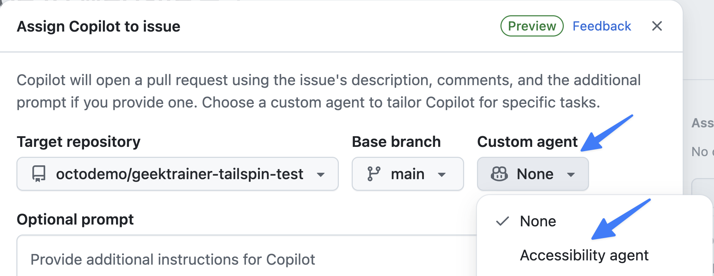

## カスタム エージェントとは

GitHub Copilot の[カスタム エージェント][custom-agents-concept]を使うと、開発ワークフローの特定のタスクや分野に合わせた AI アシスタントを作成できます。リポジトリの `.github/agents` フォルダーに Markdown ファイルを置き、命令、ベスト プラクティス、コーディング パターン、専門知識を定義すると、その種類の作業を効果的に実行できます。チームの知識を、[WCAG][wcag] に準拠するアクセシビリティ エージェント、安全なコーディングを支援するセキュリティ エージェント、一貫したテスト パターンを守るテスト エージェントなどとして再利用できます。

カスタム エージェントは、プロジェクト内の `.github/agents` またはグローバルな `~/.copilot/agents` にある Markdown ファイルで定義します。各ファイルには少なくとも `name` と `description` を持つ YAML frontmatter を記述し、その後にエージェントの動作、専門分野、命令を Markdown で記述します。

### カスタム エージェントとエージェント スキルの違い

カスタム エージェントと[エージェント スキル][agent-skills-concept]には重なる部分があります。どちらも主に Markdown ファイルで定義し、AI に作業方法を伝えます。わかりやすく区別すると、**カスタム エージェントは作業者、スキルはツール**です。

カスタム エージェントには独自のコンテキスト ウィンドウがあり、作業の一部としてスキルやほかのエージェントをまとめて利用できます。このラボのアクセシビリティ カスタム エージェントは、アクセシビリティ ガイドラインに沿ってサイトをレビュー、更新します。その作業の中で、プルリクエストのワークフロー スキルやテスト実行・管理スキルを呼び出すこともできます。

> [!NOTE]
> カスタム エージェントを作成する唯一の正解はありません。AI のほかの使い方と同様に、環境やシナリオに合わせて試し、改善してください。

カスタム エージェントを使って、次のことを確認します。

- カスタム エージェントの定義方法。
- タスクをカスタム エージェントに割り当てる方法。

## シナリオ

Tailspin Toys は、視覚能力や好みにかかわらず、すべてのユーザーがクラウドファンディング プラットフォームを利用できるようにしたいと考えています。最近のフィードバックによると、暗い背景色と文字色のコントラストが不十分で、ダーク テーマを読みづらいと感じるユーザーがいます。このアクセシビリティの問題に対処するため、デザイン チームはユーザーが切り替えられるハイコントラスト モードを求めています。

アクセシビリティは重要なため、カスタム エージェントを使って機能をすばやく作成します。

## アクセシビリティ カスタム エージェントを確認する

アクセシビリティ用のカスタム エージェントはすでに作成されています。内容を確認して、Copilot をどのようにガイドするか把握します。

Codespace に戻り、次のファイルを確認します。

1. `.github/agents/accessibility.md` を開きます。
2. `name` と `description` フィールドがある YAML frontmatter を確認します。

> [!CAUTION]
> カスタム エージェントでは、`name` と `description` を含む frontmatter が必須です。

3. 続くセクションを読みます。アクセシブルな Web サイトを作成する際の主な役割、アクセシビリティのベスト プラクティス、HTML/CSS/JavaScript のコード例、よくある問題を確認します。

## issue を作成して割り当てる

Mission control は、環境内のエージェントを操作する中心的な場所です。Copilot cloud agent にタスクを割り当て、進捗を監視し、案内を追加できます。まず、ハイコントラスト モードの作成を Copilot に割り当てます。

1. リポジトリを開きます。
2. **Issues** タブを選択します。
3. **New issue** を選択します。
4. **Blank issue** を選択します。
5. **Title** に `Add high contrast mode to website` と入力します。
6. **Description** に次を入力します。

   ```plaintext
   We need a high contrast mode for the site. There should be a toggle for high contrast which the user can set. It should store the setting in local storage on the browser.
   ```

7. **Create** を選択して issue を作成します。
8. 右側の **Assign to Copilot** を選択して割り当てダイアログを開きます。
9. 一覧から **Accessibility agent** を選択します。

   

10. **Assign** を選択します。
11. Copilot はバックグラウンドで作業を開始します。

## まとめと次のステップ

[GitHub Copilot のカスタム エージェント][custom-agents]は、特定のタスクや分野に合わせた専門 AI アシスタントです。チームの知識と標準を再利用できるエージェントとしてまとめ、Copilot の作業をガイドできます。

このレッスンでは、次のことを確認しました。

- カスタム エージェントの定義方法。
- タスクをカスタム エージェントに割り当てる方法。

Copilot がハイコントラスト モードを実装している間に、次は mission control から[エージェント セッションを監視して案内します][next-lesson]。

## リソース

- [カスタム エージェントについて][custom-agents]
- [組織でカスタム エージェントを使うための準備][org-custom-agents]
- [エンタープライズでカスタム エージェントを使うための準備][enterprise-custom-agents]

---

| [← 前のレッスン: GitHub Copilot cloud agent][previous-lesson] | [次のレッスン: エージェントの監視と管理 →][next-lesson] |
|:--|--:|

[previous-lesson]: ../2-cloud-agent/
[next-lesson]: ../4-managing-agents/
[custom-agents-concept]: https://docs.github.com/copilot/concepts/agents/cloud-agent/about-custom-agents
[agent-skills-concept]: https://docs.github.com/copilot/concepts/agents/about-agent-skills
[wcag]: https://www.w3.org/WAI/standards-guidelines/wcag/
[custom-agents]: https://docs.github.com/copilot/concepts/agents/cloud-agent/about-custom-agents
[org-custom-agents]: https://docs.github.com/copilot/how-tos/administer-copilot/manage-for-organization/prepare-for-custom-agents
[enterprise-custom-agents]: https://docs.github.com/copilot/how-tos/administer-copilot/manage-for-enterprise/manage-agents/prepare-for-custom-agents
